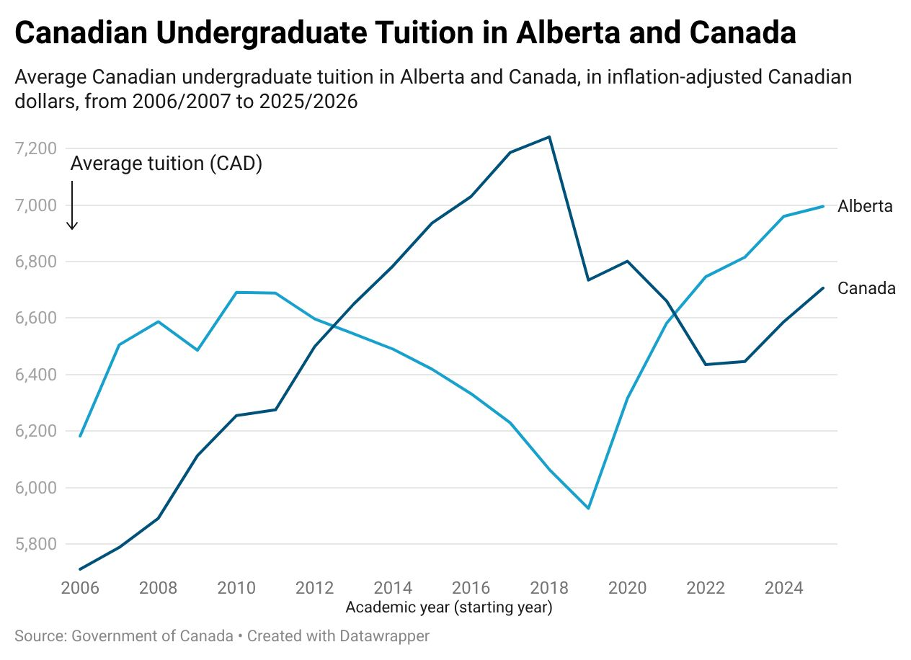
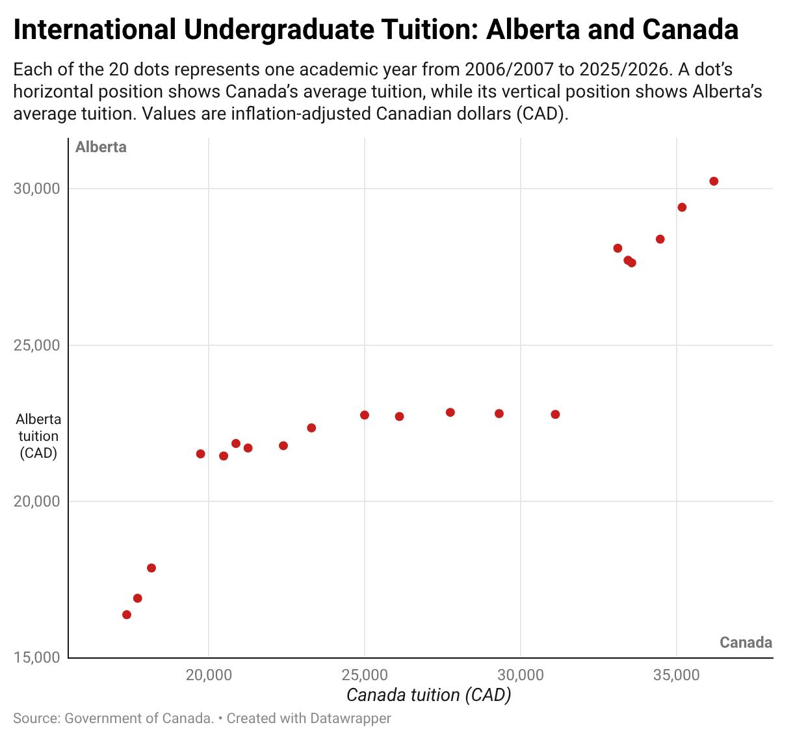
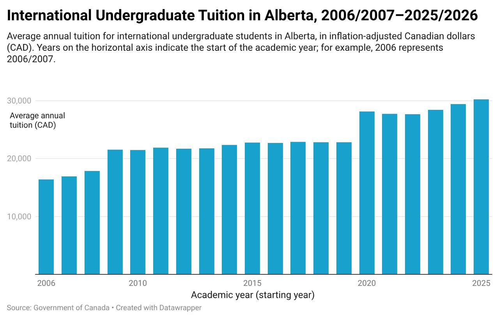
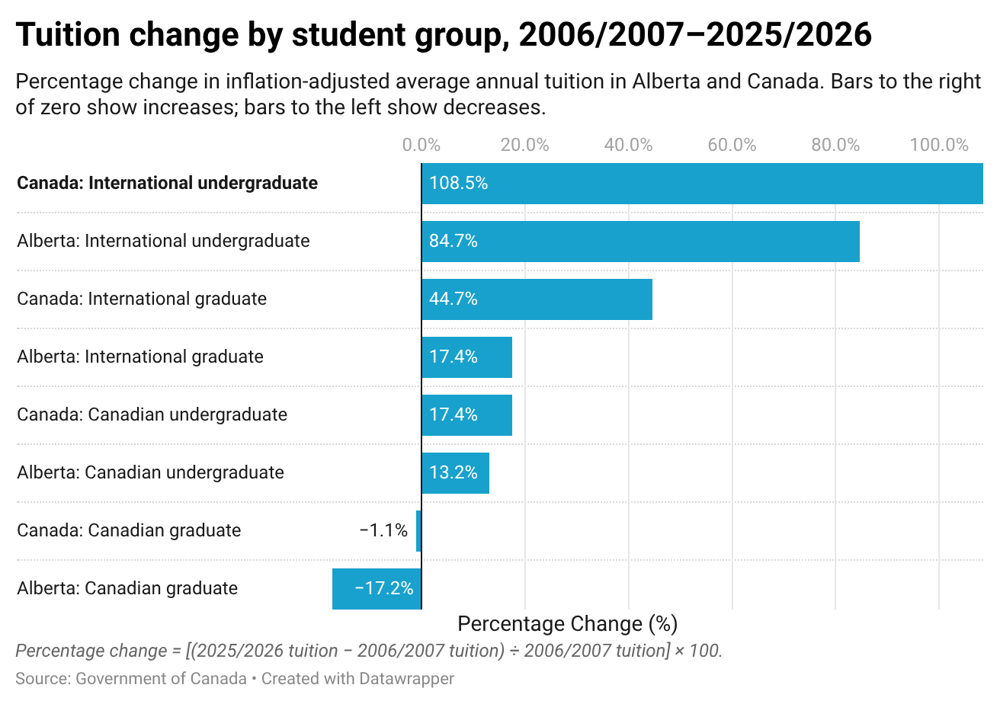

# Data Analysis and Visualization

**Manavpreet Singh** · Data analysis and visual storytelling

A collection of data analysis and visualization projects exploring higher education and river water quality in Canada. Ten original charts use Datawrapper and Tableau to compare trends, relationships, distributions, and geographic differences.

## Projects

| Project | Theme | Tools | Deliverables |
|---|---|---|---|
| [DataWrapper1](DataWrapper1/) | Higher education: tuition, 2006/2007 to 2025/2026 | Datawrapper; CSV; Python validation | Five original charts, design commentary, original and prepared data |
| [Tableau1](Tableau1/) | Natural world: river water quality, 2013 to 2016 | Tableau; CSV; Python preparation | Five original charts, methods, data cleaning, and reproducible summaries |


## Higher education: Datawrapper visualizations

The five original Datawrapper visualizations are shown below. [Full submitted commentary](DataWrapper1/report.md) and [dataset notes](DataWrapper1/Dataset/README.md) provide additional detail.

## Visualization 1: Canadian undergraduate tuition over time



**Design:** Two lines share a time axis so readers can compare trajectories and identify when the regions cross. Direct labels identify the series. The truncated vertical scale emphasizes differences, so absolute gaps should be read from the values rather than inferred from line separation.

**Finding:** In 2025/2026, Alberta's average was **$6,995**, compared with **$6,706** nationally: a **$289** difference.

## Visualization 2: International undergraduate tuition relationship



**Design:** Each point represents one academic year. Canada's tuition is on the horizontal axis and Alberta's on the vertical axis. This shows association and clusters, but the lack of year labels makes chronological interpretation harder.

**Finding:** Higher national tuition generally coincides with higher Alberta tuition. The 2025/2026 values were **$36,199** nationally and **$30,245** in Alberta, a **$5,954** gap. Association does not establish causation.

## Visualization 3: Tuition by student group in 2025/2026


**Design:** Paired dots compare Alberta and Canada within each student group on one shared scale. This makes cross-group differences visible, although small domestic-tuition differences are less prominent beside international tuition.

**Finding:** Alberta's tuition was lower in three of four groups. International undergraduate tuition was the highest in both geographies; the international graduate gap was **$6,103**.

## Visualization 4: Alberta international undergraduate tuition



**Design:** Columns use a zero baseline to keep heights proportional to tuition amounts. Annual bars highlight changes and plateaus; a line chart would make longer-term comparisons easier to follow.

**Finding:** Tuition increased from **$16,376** in 2006/2007 to **$30,245** in 2025/2026, an increase of **84.7%** in the supplied constant-dollar series.

## Visualization 5: Percentage change by student group



**Design:** Ranked horizontal bars compare percentage changes relative to each group's starting tuition. A shared zero separates increases from decreases. Endpoint comparisons summarize change but hide intermediate fluctuations.

**Finding:** International undergraduate tuition rose **108.5%** nationally and **84.7%** in Alberta. Canadian graduate tuition fell **17.2%** in Alberta and **1.1%** nationally.

## River water quality: Tableau visualizations

[Full project and methods](Tableau1/README.md) | [Submitted commentary](Tableau1/report.md)

## Visualization 1: Phosphorus measurements at four sites


**Design (Scatter plot):** Individual samples are plotted by date and colored by site, with a supplied 0.05 mg/L phosphorus reference. Unconnected points preserve sampling gaps; unequal sample frequencies limit comparisons based on point counts.

**Finding:** The largest plotted phosphorus observations occur at South Saskatchewan River at Highway 41, including 0.505 mg/L in 2013 and 0.467 mg/L in 2014.

## Visualization 2: Mean chloride concentrations in 2016


**Design (Horizontal bar chart):** Sorted, zero-based bars compare average dissolved chloride at each site. Each site has 12 observations in 2016. Means make site comparisons easy but hide monthly variability.

**Finding:** Mean concentrations were 10.60 mg/L at Highway 41, 8.43 at Carrot River, 1.47 at Canmore, and 0.28 at Lake Louise.

## Visualization 3: Samples outside supplied guidelines


**Design (Heat map):** Color and percentage labels compare site/variable rates outside their supplied thresholds. Percentages share a scale despite different variable units, but do not show exceedance magnitude or equal sampling precision.

**Finding:** Ammonia was outside the supplied threshold in 72.73% of Carrot River observations and 43.90% at Highway 41. See the validation summary for numerators and denominators.

## Visualization 4: Monthly dissolved oxygen in 2016


**Design (Seasonal line chart):** Monthly dissolved oxygen observations share a common month axis and a supplied minimum of 6.5 mg/L. Lines reveal the 2016 pattern, but are not measurements between sample dates or proof of a recurring multi-year pattern.

**Finding:** All 48 observations in 2016 stayed above 6.5 mg/L. The lowest was 7.96 mg/L at Carrot River; summer values were generally lower than winter values.

## Visualization 5: Total nitrogen distribution at Highway 41


**Design (Histogram):** Equal 0.1 mg/L bins display the distribution of total nitrogen at Highway 41. The 1.0 mg/L reference places it against the supplied upper threshold. Bin width affects the shape, and pooling years hides timing.

**Finding:** 18 of 41 unique samples, or 43.9%, exceeded 1.0 mg/L. This describes the sampled observations, not continuous river conditions.
## Repository structure

```text
DataWrapper1/
  Dataset/          Original CSV, normalized CSV, and data-quality notes
  Visualizations/   Five charts extracted from the submitted report
  README.md         Chart gallery, rationale, and findings
  report.md         Submitted written commentary
Tableau1/
  Dataset/          Original and prepared river data; validation summary
  Visualizations/   Five original Tableau chart images
  README.md         Water-quality gallery and findings
  report.md         Submitted written commentary
scripts/
  validate_data.py          Tuition data and finding checks
  prepare_water_quality.py  River data preparation and summary checks
```

## Validation

Run with Python 3.10 or newer; no third-party packages are needed:

```sh
python3 scripts/validate_data.py
python3 scripts/prepare_water_quality.py
```

The script checks the dataset grain, preservation of tuition values, academic-year normalization, and three reported endpoint gaps, then prints percentage changes for all eight geography/student-group combinations. The river script regenerates prepared data and recomputes the chloride, oxygen, nitrogen, and guideline summaries. Original editable Datawrapper and Tableau project files were not supplied; these checks do not regenerate chart images.

## Attribution and scope

The visualizations and written submission were supplied by Manavpreet Singh. The assignment identifies the data source as the Government of Canada and specifies constant dollars. The exact source table and inflation base year are not available in the supplied files. See [tuition data notes](DataWrapper1/Dataset/README.md) and [river data notes](Tableau1/Dataset/README.md) before reusing the data. River thresholds are the supplied coursework guidelines, not independently verified regulatory standards.

This repository publishes the portfolio material, not the assignment handout or the original PDF named with a student identifier. Reference screenshots guided the folder organization; the charts shown here come from the supplied final submission.
