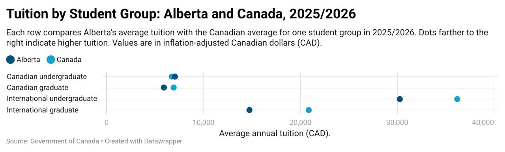

# Data Analysis and Visualization

**Manavpreet Singh** · Data analysis and visual storytelling

A collection of coursework visualizations exploring higher education in Canada. The first project uses five Datawrapper chart types to compare inflation-adjusted tuition in Alberta and Canada across 20 academic years.

## Projects

| Project | Theme | Tools | Deliverables |
|---|---|---|---|
| [DataWrapper1](DataWrapper1/) | Higher education: tuition, 2006/2007–2025/2026 | Datawrapper; CSV; Python validation | Five original charts, design commentary, original and prepared data |

[Explore the five visualizations →](DataWrapper1/README.md)



## Repository structure

```text
DataWrapper1/
  Dataset/          Original CSV, normalized CSV, and data-quality notes
  Visualizations/   Five charts extracted from the submitted report
  README.md         Chart gallery, rationale, and findings
  report.md         Submitted written commentary
scripts/
  validate_data.py  Reproducible dataset and finding checks
```

## Validation

Run with Python 3.10 or newer; no third-party packages are needed:

```sh
python3 scripts/validate_data.py
```

The script checks the dataset grain, preservation of tuition values, academic-year normalization, and three reported endpoint gaps, then prints percentage changes for all eight geography/student-group combinations. Original Datawrapper project links and editable project files were not supplied; these checks do not regenerate the chart images.

## Attribution and scope

The visualizations and written submission were supplied by Manavpreet Singh. The assignment identifies the data source as the Government of Canada and specifies constant dollars. The exact source table and inflation base year are not available in the supplied files. See [data-quality notes](DataWrapper1/Dataset/README.md) before reusing the data.

This repository publishes the portfolio material, not the assignment handout or the original PDF named with a student identifier. Reference screenshots guided the folder organization; the charts shown here come from the supplied final submission.
