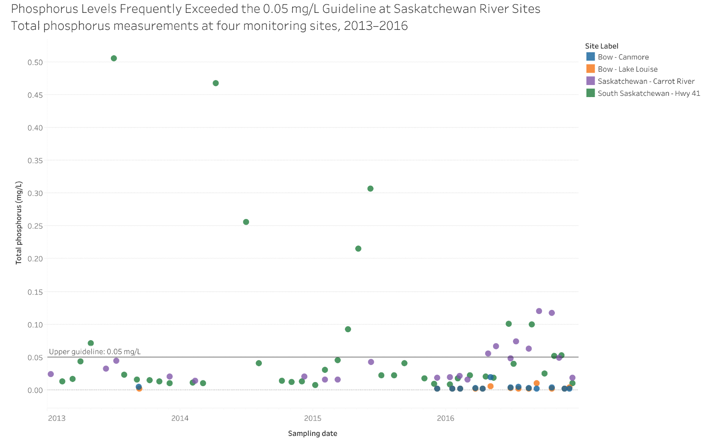
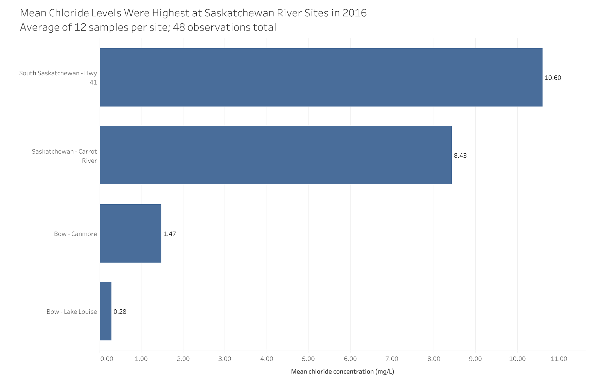
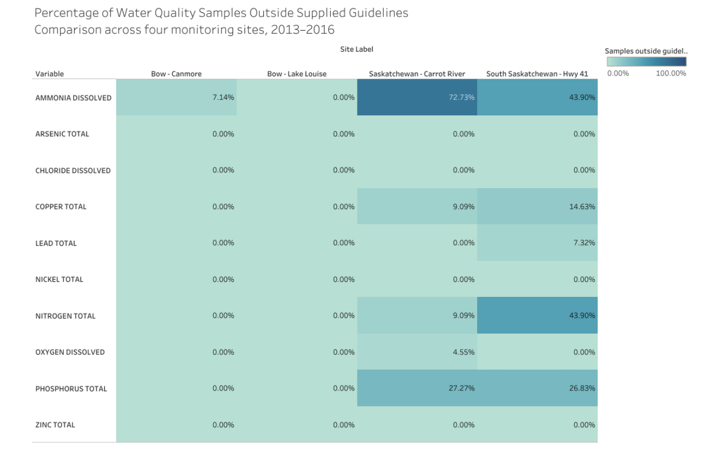
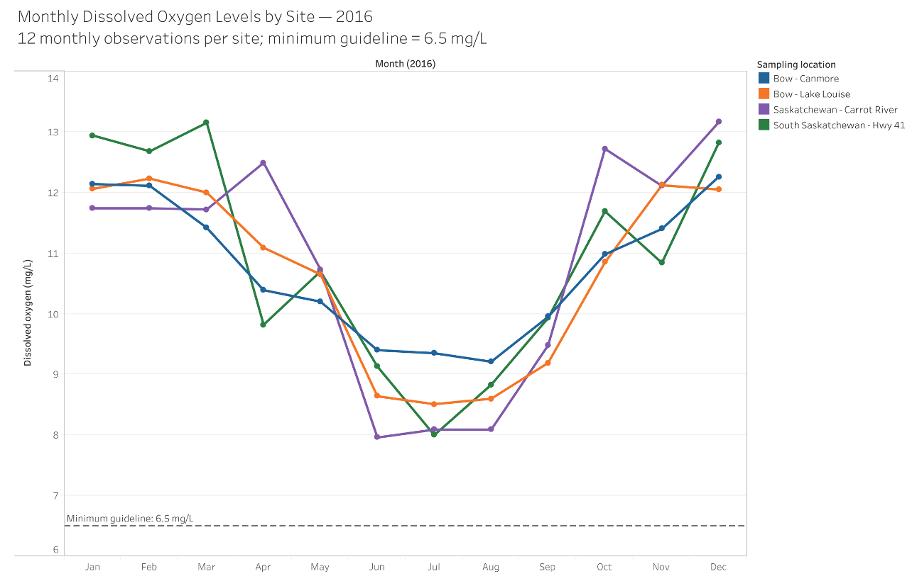
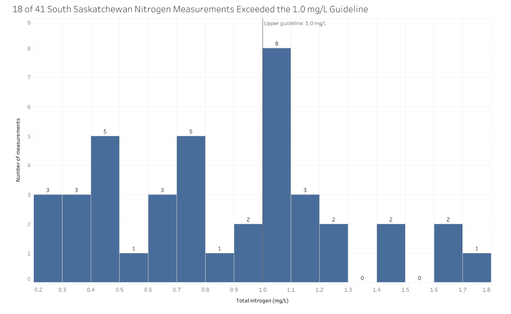

# Data Theme: Natural World

## About

This Tableau project explores river water-quality samples from four monitoring sites along the Bow, Saskatchewan, and South Saskatchewan rivers from 2013 to 2016. Five charts examine individual measurements, site averages, threshold comparison rates, seasonal patterns, and a concentration distribution.

**Manavpreet Singh**. [Submitted commentary](report.md) | [Dataset and methods](Dataset/README.md)

The gallery preserves charts extracted from the original submission. Supplied guidelines are used as coursework references; these visuals do not establish drinking-water safety, regulatory compliance, or causes of observed differences.

## Visualization 1: Phosphorus measurements at four sites

**Design (Scatter plot):** Individual samples are plotted by date and colored by site, with a supplied 0.05 mg/L phosphorus reference. Unconnected points preserve sampling gaps; unequal sample frequencies limit comparisons based on point counts.

**Finding:** The largest plotted phosphorus observations occur at South Saskatchewan River at Highway 41, including 0.505 mg/L in 2013 and 0.467 mg/L in 2014.

## Visualization 2: Mean chloride concentrations in 2016

**Design (Horizontal bar chart):** Sorted, zero-based bars compare average dissolved chloride at each site. Each site has 12 observations in 2016. Means make site comparisons easy but hide monthly variability.

**Finding:** Mean concentrations were 10.60 mg/L at Highway 41, 8.43 at Carrot River, 1.47 at Canmore, and 0.28 at Lake Louise.

## Visualization 3: Samples outside supplied guidelines

**Design (Heat map):** Color and percentage labels compare site/variable rates outside their supplied thresholds. Percentages share a scale despite different variable units, but do not show exceedance magnitude or equal sampling precision.

**Finding:** Ammonia was outside the supplied threshold in 72.73% of Carrot River observations and 43.90% at Highway 41. See the validation summary for numerators and denominators.

## Visualization 4: Monthly dissolved oxygen in 2016

**Design (Seasonal line chart):** Monthly dissolved oxygen observations share a common month axis and a supplied minimum of 6.5 mg/L. Lines reveal the 2016 pattern, but are not measurements between sample dates or proof of a recurring multi-year pattern.

**Finding:** All 48 observations in 2016 stayed above 6.5 mg/L. The lowest was 7.96 mg/L at Carrot River; summer values were generally lower than winter values.

## Visualization 5: Total nitrogen distribution at Highway 41

**Design (Histogram):** Equal 0.1 mg/L bins display the distribution of total nitrogen at Highway 41. The 1.0 mg/L reference places it against the supplied upper threshold. Bin width affects the shape, and pooling years hides timing.

**Finding:** 18 of 41 unique samples, or 43.9%, exceeded 1.0 mg/L. This describes the sampled observations, not continuous river conditions.
## Reproduce the data checks

Run `python3 scripts/prepare_water_quality.py` from the repository root. The script removes duplicates, excludes pH, standardizes dates and site labels, and recomputes summaries. It verifies 12 observations per site for both 2016 chloride and oxygen, and the 18/41 nitrogen result. The supplied data has unequal sampling frequencies across sites and years. Tableau workbooks and public links were not supplied.
